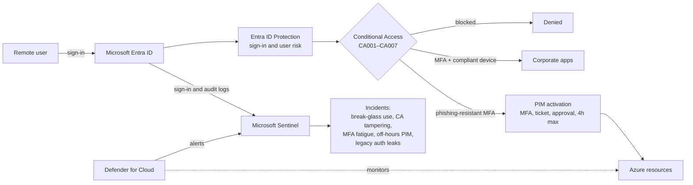

# Zero Trust Remote Access on Azure

[](https://github.com/mail2ramya17/zero-trust-azure-remote-access/actions/workflows/ci.yml)

A reference implementation of Zero Trust remote access for a Microsoft cloud estate, written as code. It uses **Microsoft Entra ID Conditional Access**, **Privileged Identity Management (PIM)**, **Microsoft Sentinel** and **Microsoft Defender for Cloud**, and it includes detections and an audit tool that check that the controls stay in place.

The design is modeled on patterns I have used in enterprise environments. All identifiers here are placeholders.

## What it does



### Conditional Access baseline

| Policy | Control |
|---|---|
| CA001 | MFA for all users on all apps |
| CA002 | Block legacy authentication (EAS, IMAP, POP, SMTP auth) |
| CA003 | Phishing-resistant MFA and 4-hour sign-in frequency for privileged roles |
| CA004 | Compliant or hybrid-joined device for remote access users |
| CA005 | Block sign-ins from outside allowed countries |
| CA006 | Medium or high sign-in risk requires MFA on every sign-in |
| CA007 | High user risk requires MFA and a secure password change |

Every policy excludes two emergency access accounts and deploys in **report-only** first.

### Least privilege with PIM

Admins get **eligible** Contributor access, never standing access. Activation requires MFA, a justification, a ticket number and group approval, and it expires after 4 hours.

### Detections (Microsoft Sentinel, KQL)

| Rule | Detects | ATT&CK |
|---|---|---|
| [`breakglass_signin.kql`](detections/breakglass_signin.kql) | Any sign-in by an emergency access account | T1078.004 |
| [`ca_policy_tampering.kql`](detections/ca_policy_tampering.kql) | Conditional Access policy added, changed, disabled or deleted | T1562 |
| [`mfa_fatigue.kql`](detections/mfa_fatigue.kql) | 3+ MFA denials for one user in an hour | T1621 |
| [`pim_activation_off_hours.kql`](detections/pim_activation_off_hours.kql) | Role activation outside business hours | T1078, T1098 |
| [`legacy_auth_success.kql`](detections/legacy_auth_success.kql) | Successful legacy-protocol sign-in (a gap in CA002) | T1078 |

### Policy drift audit

[`scripts/ca_policy_audit.py`](scripts/ca_policy_audit.py) checks a Microsoft Graph export of live Conditional Access policies against this baseline. It catches missing MFA, unblocked legacy auth, admins without phishing-resistant MFA, break-glass accounts that are not excluded, policies stuck in report-only, and growing group exclusions.

```text
$ python scripts/ca_policy_audit.py tests/fixtures/baseline_gaps.json --break-glass <id1> --break-glass <id2>
[FAIL] ZT-01  No enforced policy requires MFA for all users on all apps.
[FAIL] ZT-02  No enforced policy blocks legacy authentication for all users.
[FAIL] ZT-03  Phishing-resistant MFA not enforced for: Conditional Access Administrator, ...
[FAIL] ZT-04  'CA001-Global-RequireMFA-AllUsers' does not exclude emergency account(s): ...
[WARN] ZT-05  Policy in report-only, not enforced: 'CA001-Global-RequireMFA-AllUsers'.
[WARN] ZT-06  'Admins-MFA' excludes 3 groups; review for exclusion creep.
```

It exits with code 1 on any failure, so it can gate a scheduled pipeline.

## Repository layout

```text
terraform/            Entra ID, Conditional Access, PIM, Sentinel, Defender for Cloud
detections/           KQL analytics rules loaded into Sentinel by Terraform
scripts/              Conditional Access drift audit (Python, no dependencies)
tests/                Unit tests and sample Graph exports
docs/architecture.md  Design principles, request flow, licensing assumptions
docs/threat-model.md  Threats, ATT&CK techniques, controls and residual risk
docs/rollout.md       Report-only to enforced rollout plan
.github/workflows/    Terraform fmt/validate and Python tests
```

## Quick start

```bash
# Run the audit tests
pip install pytest
pytest -q

# Deploy (needs Entra ID P2, Intune, and rights to manage CA, PIM and the subscription)
cd terraform
cp terraform.tfvars.example terraform.tfvars   # fill in real values, never commit
terraform init
terraform plan
```

Read [docs/rollout.md](docs/rollout.md) before enforcing any policy.

## Framework alignment

- **NIST SP 800-207** Zero Trust Architecture: identity-centric policy decision and enforcement
- **CISA Zero Trust Maturity Model**: Identity and Devices pillars, plus Visibility and Analytics
- **MITRE ATT&CK**: detections mapped to techniques in [docs/threat-model.md](docs/threat-model.md)

## License

MIT
